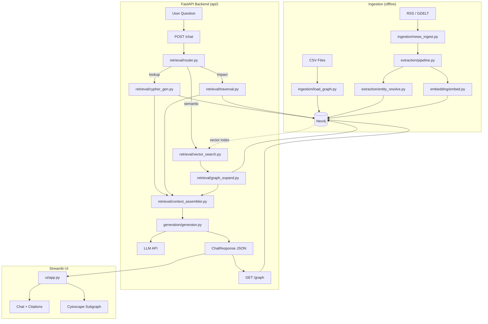

# ChainSight — Product Requirements Document

> **Version:** 1.0 · **Date:** 2026-10-24 · **Author:** (your name)  
> **Status:** Draft — awaiting builder sign-off on open decisions (§17)

---

## Assumptions (stated upfront, flag if wrong)

| # | Assumption |
|---|-----------|
| A1 | LLM provider = Google Gemini 1.5 Flash (free tier, 15 RPM / 1M TPM). Fallback: Groq Llama-3.1-8B. |
| A2 | Embeddings = `all-MiniLM-L6-v2` via `sentence-transformers` (local, free, 384 dims). |
| A3 | Neo4j = AuraDB Free (1 instance, 200k node / 400k rel limit) OR local Docker. You decide (§17-D1). |
| A4 | News source = RSS feeds (BBC, Reuters, AP) + GDELT GKG CSV (free, no API key). NewsAPI free tier (100 req/day) optional. |
| A5 | Synthetic supply chain modeled after a fictional mid-size electronics OEM with ~3 product families, 30-50 suppliers, 8-12 ports. |
| A6 | UI = Streamlit (MVP); no React upgrade in scope for the 6-week timeline. |
| A7 | Evaluation ground truth is hand-authored by you; I provide the question templates and rubric only. |
| A8 | Docker Compose is the primary local dev environment; no Kubernetes. |
| A9 | "Real disruption news" = articles from the last 12 months fetched once and stored; not live streaming. |
| A10 | CI = GitHub Actions free tier (2000 min/month). |

---

## 1. Product Overview

### 1.1 Problem

Supply chain managers and analysts need to answer **multi-hop risk questions** like:

- *"The Port of Los Angeles is disrupted by a labor strike. Which of our products lose a critical supplier, and what alternatives exist?"*
- *"Component C-4702 comes from a single supplier in Taiwan. What is our total revenue exposure?"*

Plain **vector RAG** (embedding similarity search over documents) fails these questions because:
1. The answer requires **traversing a graph** (port → supplier → component → product → customer).
2. No single chunk contains all the facts; reasoning requires joining structured and unstructured knowledge.
3. Hallucination risk is high because the model must infer missing links.

**Graph RAG** combines a structured knowledge graph with semantic search, enabling faithful, cited, multi-hop answers.

### 1.2 Target Users / Personas

| Persona | Description | Primary Question Type |
|---------|-------------|----------------------|
| **Portfolio Reviewer** (primary) | Recruiter, hiring manager, or professor evaluating the builder's technical depth | "What can this student do?" |
| **Demo User** | Anyone given a link during a job interview or hackathon presentation | Multi-hop impact questions |
| **Builder** (self) | The student — needs the system to be understandable and explainable at every layer | Architectural clarity |

> **Note:** This is a portfolio project, not a production SaaS. "Users" in user stories refer to the *demo user* persona.

### 1.3 Goals

| ID | Goal | Success Indicator |
|----|------|-------------------|
| G1 | Demonstrate measurable Graph RAG superiority over vector-only RAG | Graph RAG ≥ 20% higher answer quality score on multi-hop benchmark |
| G2 | Answer multi-hop supply chain questions with cited sources | ≥ 80% of answers include ≥ 1 cited source |
| G3 | Visualize the subgraph used to answer each question | Subgraph renders within 3 seconds of answer generation |
| G4 | Build a system the builder can fully explain in a 30-minute interview | No black-box components (custom retrieval, not LangChain chains) |
| G5 | Deploy-ready on a laptop with one command | `docker compose up` starts the full stack |

### 1.4 Non-Goals

- Real-time supply chain monitoring or live data feeds
- Multi-tenant authentication or user management
- Production SLAs, GDPR compliance, or security hardening
- Fine-tuning any LLM
- Mobile-responsive UI
- Graph editing / write operations from the UI

---

## 2. Scope Definition

### 2.1 MVP (6 weeks, ~60 hours)

| # | Feature |
|---|---------|
| M1 | Synthetic supply chain data: 30–50 suppliers, 8–12 ports, 3 product families ingested into Neo4j |
| M2 | News ingestion: 50–200 articles chunked, embedded, stored |
| M3 | LLM extraction pipeline: entity + relation extraction with schema constraints |
| M4 | Entity resolution: embedding + exact-match deduplication |
| M5 | Vector index on Article chunks; graph vector index on node descriptions |
| M6 | Three retrieval strategies + intent router |
| M7 | FastAPI backend with `/chat` and `/graph` endpoints |
| M8 | Streamlit UI: chat pane + subgraph visualization + source citations |
| M9 | Evaluation: 30-question benchmark, baseline vs Graph RAG, results table |
| M10 | Docker Compose full-stack setup |
| M11 | `AGENTS.md`, `DECISIONS.md`, structured README |

### 2.2 Stretch Goals (only if weeks 5–6 have slack)

| # | Feature | Estimate |
|---|---------|----------|
| S1 | React + D3.js graph frontend (replace Streamlit) | +8h |
| S2 | Live RSS polling with Celery/APScheduler | +4h |
| S3 | Gemini structured output with function calling instead of prompt-parsed JSON | +3h |
| S4 | Confidence score display per answer | +2h |
| S5 | "Export to PDF" report for a query | +3h |

### 2.3 Explicitly Out of Scope

- Multi-user auth, sessions, or persistence of chat history beyond the demo
- Real supplier data (legal and privacy concerns)
- Graph schema editing via the UI
- Kubernetes or cloud deployment (GCP, AWS, Azure)
- Fine-tuning or RLHF
- Streaming tokens to the UI (use full response only)
- Integration with ERP systems (SAP, Oracle)
- Any payment or billing logic

---

## 3. User Stories and Acceptance Criteria

### US-01: Multi-hop Impact Query
**As a** demo user,  
**I want to** ask "Port of Shanghai is disrupted — which products are at risk and do we have alternative suppliers?",  
**So that** I can understand the downstream risk of a single supply chain disruption.

**Acceptance Criteria:**
- [ ] The system identifies all suppliers that SHIPS_VIA the disrupted port
- [ ] It traverses to components those suppliers produce
- [ ] It traverses to products those components are PART_OF
- [ ] It lists any alternative suppliers (ALTERNATIVE_FOR edges)
- [ ] The answer text cites at least one Article node if a relevant news article exists
- [ ] The subgraph visualization highlights the traversal path
- [ ] Response latency ≤ 10 seconds

### US-02: Single-hop Lookup
**As a** demo user,  
**I want to** ask "Who supplies component C-4702?",  
**So that** I can find supplier information quickly.

**Acceptance Criteria:**
- [ ] The system returns the correct supplier name(s) from the graph
- [ ] Exact-match Cypher is used (not vector search) for a named entity lookup
- [ ] Response latency ≤ 5 seconds

### US-03: Semantic News Search
**As a** demo user,  
**I want to** ask "What recent disruptions have affected Asian shipping lanes?",  
**So that** I can find relevant news without knowing exact entity names.

**Acceptance Criteria:**
- [ ] The system performs vector similarity search over Article chunks
- [ ] Top-5 relevant chunks are retrieved and used in the answer
- [ ] Each cited article shows: title, source, date, URL (or synthetic URL)
- [ ] The system expands to related graph nodes (ports, suppliers) mentioned in articles

### US-04: Unanswerable Question Handling
**As a** demo user,  
**I want to** ask something outside the knowledge base (e.g., "What is our CEO's salary?"),  
**So that** the system gracefully declines rather than hallucinating.

**Acceptance Criteria:**
- [ ] The system returns a refusal response ("I don't have information about…")
- [ ] No graph nodes or articles are fabricated in the response
- [ ] The subgraph pane shows "No relevant subgraph" or is empty

### US-05: Subgraph Visualization
**As a** demo user,  
**I want to** see which graph nodes were used to generate the answer,  
**So that** I can understand the reasoning path.

**Acceptance Criteria:**
- [ ] Nodes are rendered with color by label (Supplier=blue, Port=orange, etc.)
- [ ] Edges are labeled with relationship type
- [ ] Clicking a node shows its properties in a side panel
- [ ] The visualization updates with each new query

### US-06: System Setup
**As a** builder,  
**I want to** spin up the full stack with `docker compose up`,  
**So that** demo setup takes < 5 minutes.

**Acceptance Criteria:**
- [ ] `docker compose up` starts Neo4j, FastAPI backend, Streamlit frontend
- [ ] A `seed` script populates synthetic data + example news on first run
- [ ] All secrets loaded from `.env` file (template provided as `.env.example`)
- [ ] Health check endpoints exist for each service

---

## 4. System Architecture

### 4.1 Components

| Component | Tech | Responsibility |
|-----------|------|----------------|
| **Ingestion CLI** | Python scripts | Load CSVs → Neo4j; fetch/clean news |
| **Extraction Pipeline** | Python + LLM | NER + RE from articles; entity resolution |
| **Embedding Service** | sentence-transformers | Generate and store embeddings |
| **Neo4j** | AuraDB Free / Docker | Graph + vector index storage |
| **Retrieval Layer** | Python (custom) | Intent router + 3 strategies |
| **Generation Layer** | Python + LLM | Prompt assembly + structured answer |
| **FastAPI Backend** | Python | REST API: /chat, /graph, /health |
| **Streamlit UI** | Python | Chat + vis + citations |
| **Evaluation Runner** | Python + pytest | Benchmark harness |

### 4.2 Data Flow

```
User Question
    │
    ▼
[FastAPI /chat]
    │
    ▼
[Intent Router] ─── classifies → {lookup, impact_traversal, semantic, unanswerable}
    │
    ├──(lookup)──────────→ [Text-to-Cypher] → Neo4j MATCH → structured context
    ├──(impact_traversal)→ [Template Cypher] → Neo4j traversal → graph context
    ├──(semantic)────────→ [Vector Search] → top-k chunks → [Graph Expand] → context
    └──(unanswerable)────→ refuse
    │
    ▼
[Context Assembler] (deduplicate, rank, trim to token budget)
    │
    ▼
[LLM Answer Generator] (structured JSON output: answer + citations + subgraph_ids)
    │
    ▼
[FastAPI Response] → Streamlit UI
                          ├── Chat pane (answer + citations)
                          └── Graph pane (subgraph_ids → /graph → Neo4j → Cytoscape.js)
```

### 4.3 Architecture Diagram



---

## 5. Graph Schema Specification

### 5.1 Node Labels and Properties

| Label | Required Properties | Optional Properties | Notes |
|-------|-------------------|--------------------|----|
| `Supplier` | `id: str`, `name: str`, `country_code: str` | `reliability_score: float`, `lead_time_days: int`, `tier: int` (1/2/3) | Tier = supply chain tier |
| `Facility` | `id: str`, `name: str`, `type: str` (factory/warehouse/dc) | `capacity_units: int`, `lat: float`, `lon: float` | |
| `Component` | `id: str`, `name: str`, `category: str` | `unit_cost_usd: float`, `lead_time_days: int`, `is_sole_sourced: bool` | |
| `Product` | `id: str`, `name: str`, `sku: str` | `revenue_usd_annual: float`, `margin_pct: float` | |
| `Port` | `id: str`, `name: str`, `country_code: str`, `un_locode: str` | `lat: float`, `lon: float`, `throughput_teu_annual: int` | UN/LOCODE is real reference data |
| `Country` | `code: str` (ISO 3166-1 alpha-2), `name: str` | `region: str`, `risk_index: float` | |
| `Customer` | `id: str`, `name: str`, `country_code: str` | `annual_revenue_usd: float`, `segment: str` | |
| `Event` | `id: str`, `type: str`, `description: str`, `start_date: date` | `end_date: date`, `severity: str` (low/med/high/critical), `status: str` | Extracted from news |
| `Article` | `id: str`, `title: str`, `source: str`, `url: str`, `published_date: date`, `chunk_index: int` | `text: str`, `embedding: list[float]` | One node per chunk |

> **Embedding storage:** Neo4j vector index on `Article.embedding` and on a `description_embedding` property for Supplier, Port, Component.

### 5.2 Relationship Types

| Relationship | Direction | Properties | Meaning |
|-------------|-----------|-----------|---------|
| `OPERATES` | `(Supplier)-[:OPERATES]->(Facility)` | `since_year: int` | Supplier operates a facility |
| `PRODUCES` | `(Supplier)-[:PRODUCES]->(Component)` | `annual_volume: int`, `is_primary: bool` | Supplier produces a component |
| `PART_OF` | `(Component)-[:PART_OF]->(Product)` | `quantity: int`, `is_critical: bool` | Component is in a product's BOM |
| `SHIPS_VIA` | `(Supplier)-[:SHIPS_VIA]->(Port)` | `primary: bool`, `avg_transit_days: int` | Supplier uses a port |
| `LOCATED_IN` | `(Supplier\|Facility\|Port)-[:LOCATED_IN]->(Country)` | *(none)* | Geographic containment |
| `AFFECTS` | `(Event)-[:AFFECTS]->(Port\|Supplier\|Facility\|Country)` | `impact_level: str`, `confidence: float` | Event impacts an entity |
| `MENTIONS` | `(Article)-[:MENTIONS]->(Supplier\|Port\|Event\|Country\|Component)` | `confidence: float` | Extracted NER link |
| `ALTERNATIVE_FOR` | `(Supplier)-[:ALTERNATIVE_FOR]->(Supplier)` | `component_id: str`, `qualification_status: str` | Alternative supplier for same component |
| `SHIPS_TO` | `(Facility)-[:SHIPS_TO]->(Customer)` | `annual_volume_units: int` | Fulfillment path |
| `NEXT_CHUNK` | `(Article)-[:NEXT_CHUNK]->(Article)` | *(none)* | Chunk ordering for context window |

### 5.3 Constraints and Indexes

```cypher
-- Uniqueness constraints (also create a B-tree index)
CREATE CONSTRAINT supplier_id IF NOT EXISTS FOR (s:Supplier) REQUIRE s.id IS UNIQUE;
CREATE CONSTRAINT component_id IF NOT EXISTS FOR (c:Component) REQUIRE c.id IS UNIQUE;
CREATE CONSTRAINT product_id IF NOT EXISTS FOR (p:Product) REQUIRE p.id IS UNIQUE;
CREATE CONSTRAINT port_unlocode IF NOT EXISTS FOR (p:Port) REQUIRE p.un_locode IS UNIQUE;
CREATE CONSTRAINT article_id IF NOT EXISTS FOR (a:Article) REQUIRE a.id IS UNIQUE;
CREATE CONSTRAINT country_code IF NOT EXISTS FOR (c:Country) REQUIRE c.code IS UNIQUE;
CREATE CONSTRAINT event_id IF NOT EXISTS FOR (e:Event) REQUIRE e.id IS UNIQUE;

-- Vector indexes
CREATE VECTOR INDEX article_embedding IF NOT EXISTS
  FOR (a:Article) ON (a.embedding)
  OPTIONS {indexConfig: {`vector.dimensions`: 384, `vector.similarity_function`: 'cosine'}};

CREATE VECTOR INDEX node_desc_embedding IF NOT EXISTS
  FOR (n:Supplier) ON (n.description_embedding)
  OPTIONS {indexConfig: {`vector.dimensions`: 384, `vector.similarity_function`: 'cosine'}};

-- Full-text index for entity resolution
CREATE FULLTEXT INDEX entity_name_ft IF NOT EXISTS
  FOR (n:Supplier|Port|Component|Product|Country|Customer) ON EACH [n.name];
```

### 5.4 Example Cypher Queries

**Q1 — Impact traversal: disrupted port → exposed products**
```cypher
MATCH (port:Port {name: $port_name})<-[:SHIPS_VIA]-(s:Supplier)
      -[:PRODUCES]->(c:Component)
      -[:PART_OF]->(p:Product)
RETURN port.name AS port, s.name AS supplier,
       c.name AS component, p.name AS product, p.revenue_usd_annual
ORDER BY p.revenue_usd_annual DESC;
```

**Q2 — Find alternative suppliers for a disrupted supplier**
```cypher
MATCH (disrupted:Supplier {name: $supplier_name})-[:ALTERNATIVE_FOR]-(alt:Supplier)
MATCH (disrupted)-[:PRODUCES]->(c:Component)
WHERE (alt)-[:PRODUCES]->(c)
RETURN alt.name, alt.country_code, alt.reliability_score, c.name
ORDER BY alt.reliability_score DESC;
```

**Q3 — Sole-sourced components with high-risk geography**
```cypher
MATCH (s:Supplier)-[:PRODUCES]->(c:Component {is_sole_sourced: true})
      -[:PART_OF]->(p:Product)
MATCH (s)-[:LOCATED_IN]->(country:Country)
WHERE country.risk_index > 0.6
RETURN c.name, s.name, country.name, country.risk_index, p.name
ORDER BY country.risk_index DESC;
```

**Q4 — Recent events affecting a port**
```cypher
MATCH (e:Event)-[:AFFECTS]->(port:Port {name: $port_name})
WHERE e.start_date >= date() - duration({months: 6})
RETURN e.type, e.description, e.severity, e.start_date
ORDER BY e.start_date DESC LIMIT 10;
```

**Q5 — Full exposure path for a customer**
```cypher
MATCH path = (c:Customer {name: $customer_name})<-[:SHIPS_TO]-(:Facility)
             <-[:OPERATES]-(:Supplier)-[:PRODUCES]->(:Component)
             -[:PART_OF]->(p:Product)
RETURN path LIMIT 25;
```

**Q6 — Articles mentioning a port + nearby event**
```cypher
MATCH (a:Article)-[:MENTIONS]->(port:Port {name: $port_name})
OPTIONAL MATCH (a)-[:MENTIONS]->(e:Event)
RETURN a.title, a.source, a.published_date, e.type
ORDER BY a.published_date DESC LIMIT 5;
```

**Q7 — Concentration risk: how many products depend on one country**
```cypher
MATCH (country:Country {code: $country_code})<-[:LOCATED_IN]-(s:Supplier)
      -[:PRODUCES]->(c:Component)-[:PART_OF]->(p:Product)
RETURN country.name, count(DISTINCT p) AS exposed_products,
       count(DISTINCT s) AS suppliers_count,
       sum(p.revenue_usd_annual) AS total_revenue_at_risk;
```

**Q8 — 2-hop: suppliers sharing a vulnerable port**
```cypher
MATCH (s1:Supplier)-[:SHIPS_VIA]->(p:Port)<-[:SHIPS_VIA]-(s2:Supplier)
WHERE s1 <> s2 AND p.name = $port_name
RETURN DISTINCT s1.name, s2.name, p.name;
```

**Q9 — Vector similarity search on Article chunks (via index)**
```cypher
CALL db.index.vector.queryNodes('article_embedding', 5, $query_embedding)
YIELD node AS article, score
MATCH (article)-[:MENTIONS]->(entity)
RETURN article.title, article.text, score, collect(entity.name) AS mentioned_entities
ORDER BY score DESC;
```

**Q10 — Components with no alternative suppliers and active events on their primary port**
```cypher
MATCH (c:Component {is_sole_sourced: true})<-[:PRODUCES]-(s:Supplier)
      -[:SHIPS_VIA]->(port:Port)<-[:AFFECTS]-(e:Event)
WHERE e.status = 'active' AND e.severity IN ['high', 'critical']
RETURN c.name, s.name, port.name, e.description, e.severity;
```

---

## 6. Data Plan

### 6.1 Synthetic Structured Data

**Generation approach:** Python script (`data/generate_synthetic.py`) using `faker`, `random`, and hand-crafted distributions. Seed with `RANDOM_SEED=42` for reproducibility.

#### Size Targets

| Entity | Count | Notes |
|--------|-------|-------|
| Country | 20 | Real ISO codes; 8 high-risk (risk_index > 0.6) |
| Port | 12 | Real UN/LOCODEs (Shanghai, Rotterdam, LA, Singapore, etc.) |
| Supplier | 40 | 10 Tier-1, 20 Tier-2, 10 Tier-3 |
| Facility | 55 | 1–2 per supplier |
| Component | 60 | 20 per product family; 15 marked sole-sourced |
| Product | 9 | 3 per family (e.g., Laptop, Tablet, Server) |
| Customer | 15 | Mix of B2B segments |
| Shipment | 200 | Historical records linking facility → customer |
| ALTERNATIVE_FOR edges | 25 | ~40% of Tier-1 have alternatives |

#### Realism Rules

- Suppliers in East Asia (CN, TW, KR, VN) = 60% of total (realistic electronics supply chain)
- Sole-sourced components preferentially assigned to Tier-1 suppliers in high-risk countries
- `reliability_score` sampled from Beta(8, 2) (most are reliable; a few are poor)
- `lead_time_days` sampled from LogNormal(μ=3.5, σ=0.5) (mostly 20–60 days)
- Port throughput from real 2023 statistics (approximate values only)

#### Output Format

CSVs saved to `data/raw/synthetic/`: `suppliers.csv`, `facilities.csv`, `components.csv`, `products.csv`, `bom.csv`, `ports.csv`, `countries.csv`, `customers.csv`, `shipments.csv`, `alternative_suppliers.csv`

### 6.2 News Data

| Source | Method | Rate Limit | License |
|--------|--------|-----------|---------|
| BBC RSS (`feeds.bbci.co.uk`) | `feedparser` | No limit stated; be polite (10 req/session) | Fair use / public |
| Reuters RSS | `feedparser` | Polite | Public |
| GDELT GKG v2 | Bulk CSV download (daily) | None (S3-style) | Public domain |
| NewsAPI.org | REST API | 100 req/day (free) | ToS: non-commercial research |
| Wikipedia | `wikipedia-api` Python lib | 200 req/s limit; be conservative | CC BY-SA 4.0 |

**Target:** 100–200 article chunks (after deduplication). Articles dated within last 12 months, filtered to keywords: `["port strike", "shipping disruption", "semiconductor shortage", "supply chain", "logistics delay", "trade embargo"]`.

**Chunking:** Fixed 400-token chunks with 50-token overlap. Use `tiktoken` for token counting. Store each chunk as a separate `Article` node with `chunk_index`.

**Cleaning:** Strip HTML tags, normalize whitespace, filter chunks < 100 tokens. Language filter: English only (fasttext `langdetect` or `langid`).

### 6.3 Real Reference Data

| Data | Source | How |
|------|--------|-----|
| Port UN/LOCODEs | UNECE public CSV | Download once, commit to `data/reference/` |
| Country ISO codes + names | `pycountry` library | Runtime |
| Country risk index | Synthetic (0.0–1.0 float); loosely inspired by OECD Country Risk Classification | Hard-coded lookup table |

---

## 7. Extraction and Entity Resolution Design

### 7.1 Extraction Pipeline

**Trigger:** Run after news ingestion, once per article (idempotent via article ID check).

**Prompt Strategy:** Single LLM call per chunk using a **constrained schema prompt**. The prompt provides:
1. The chunk text
2. The exact allowed node labels and relationship types (from §5)
3. An output JSON schema (see §7.2)
4. 2 few-shot examples (hard-coded)
5. Instruction: "Only extract entities and relationships explicitly stated in the text. Do not infer."

**Model call:** Gemini 1.5 Flash with `response_mime_type: "application/json"` and `response_schema` (Pydantic model converted to JSON Schema).

**Token budget:** Max 800 input tokens per chunk. If chunk > 800 tokens, split further before extraction.

### 7.2 JSON Output Schema

```json
{
  "entities": [
    {
      "label": "Port | Supplier | Event | Country | Component | Product",
      "name": "string",
      "properties": {}
    }
  ],
  "relationships": [
    {
      "type": "AFFECTS | MENTIONS | SHIPS_VIA | LOCATED_IN",
      "from_name": "string",
      "from_label": "string",
      "to_name": "string",
      "to_label": "string",
      "properties": {
        "confidence": 0.0
      }
    }
  ],
  "events": [
    {
      "id": "auto",
      "type": "strike | storm | congestion | embargo | shortage | other",
      "description": "string",
      "start_date": "YYYY-MM-DD or null",
      "severity": "low | medium | high | critical"
    }
  ]
}
```

**Validation:** Parse with Pydantic. On validation error → log + skip chunk (do not crash pipeline). Max 2 retry attempts with "Fix the following JSON errors: {errors}" appended.

### 7.3 Entity Resolution

**Goal:** Prevent duplicate nodes for the same real entity (e.g., "Port of Shanghai" = "Shanghai Port" = "CNSHA").

**3-stage resolution:**

| Stage | Method | Threshold | Applied To |
|-------|--------|-----------|-----------|
| 1. Exact match | `un_locode` for Ports; `id` for synthetic nodes | 100% | Port, Country |
| 2. Full-text fuzzy match | Neo4j fulltext index (`entity_name_ft`) + Levenshtein ≤ 2 | Candidate | Supplier, Port name |
| 3. Embedding cosine similarity | Encode extracted name; query `node_desc_embedding` index; top-1 | cos ≥ 0.88 | All labels |

**Decision:** If all 3 stages fail → create a new node marked `source: "extracted"`.  
If stage 2 or 3 succeeds → merge with existing node; add `MENTIONS` edge from Article to existing node.

**Deduplication of Article nodes:** Hash `(url + chunk_index)` → skip if already in graph.

---

## 8. Retrieval and Generation Design

### 8.1 Intent Router

A lightweight classifier (not an LLM call — use rule-based + embedding similarity to save cost):

| Intent | Pattern | Routing |
|--------|---------|---------|
| `lookup` | Named entity + factual question (who, what, where) | Text-to-Cypher |
| `impact_traversal` | Disruption/risk + propagation (which products, exposure) | Template Cypher |
| `semantic` | Open-ended, no named entity, keyword-heavy | Vector Search + Graph Expand |
| `unanswerable` | Completely out of domain | Refuse template |

**Implementation:** Classify by regex patterns on named entity detection (`spacy` `en_core_web_sm` for NER) plus keyword lists. If ambiguous, default to `semantic`.

### 8.2 Retrieval Strategies

#### Strategy 1: Text-to-Cypher
- **When:** `lookup` intent; named entities recognized in query
- **Method:** LLM (Gemini Flash) given graph schema summary + query → generates Cypher; execute against Neo4j; validate result is non-empty
- **Guardrail:** Only `MATCH`/`RETURN` allowed (block `CREATE`, `MERGE`, `DELETE` via regex). If Cypher execution fails, fall back to vector search.
- **Context output:** Tabular result from Cypher as JSON

#### Strategy 2: Template Impact Traversal
- **When:** `impact_traversal` intent; disruption keyword + port/supplier named entity
- **Method:** Pre-written parameterized Cypher templates (like Q1, Q2, Q7 from §5.4). Router maps intent sub-type to template. Fill `$params` from extracted entities.
- **Templates to implement:** `port_disruption_impact`, `supplier_disruption_impact`, `country_concentration_risk`, `alternative_supplier_finder`
- **Context output:** Graph traversal result as structured JSON + list of node IDs for visualization

#### Strategy 3: Vector Search + Graph Expand
- **When:** `semantic` intent; no named entity; open-ended question
- **Method:**
  1. Embed the query with same model as Article embeddings
  2. Query `article_embedding` vector index → top-5 chunks
  3. For each chunk, retrieve `MENTIONS` edges → collect mentioned entity node IDs
  4. Fetch 1-hop neighborhood of those entities
  5. Combine: chunk text + graph neighborhood JSON
- **Context output:** Ranked chunk texts + graph context

### 8.3 Context Assembler

- Deduplicate nodes/edges across multiple strategy outputs
- Token budget: max 3,000 tokens of context passed to generation LLM
- Ranking: graph-derived facts first (higher reliability), then article chunks
- Include: node properties, relationship types, article title+date+source+snippet (not full text)

### 8.4 Generation

**Prompt structure:**
```
System: You are ChainSight, a supply chain risk analyst...
        Rules: Only use facts from [CONTEXT]. Cite sources as [Source N].
               If insufficient context, reply "I don't have enough information..."

User: [QUESTION]

Context:
[STRUCTURED GRAPH FACTS]
[ARTICLE EXCERPTS WITH SOURCES]

Answer in JSON:
{
  "answer": "...",
  "citations": [{"source_id": "art_123", "title": "...", "url": "...", "date": "..."}],
  "subgraph_node_ids": ["sup_001", "port_SHA", ...],
  "confidence": "high | medium | low",
  "retrieval_strategy": "lookup | impact_traversal | semantic | refused"
}
```

**Hallucination guardrails:**
1. System prompt instructs "only use facts from context" (standard)
2. Post-generation: verify any named entity in the answer exists in the context (string match)
3. If `citations` is empty but `retrieval_strategy != "refused"`, log a warning
4. Citation format in UI: `[1] Reuters, "Port Strike Halts...", 2025-03-12`

### 8.5 "I Don't Know" Behavior

Trigger conditions (checked before LLM call):
- `unanswerable` intent from router
- Strategy returns empty results (no Cypher rows, no vector hits with score > 0.5)
- Post-generation entity hallucination check fails

Response: `{"answer": "I don't have enough information in the knowledge base to answer this question reliably. [Optional: suggest rephrasing]", "citations": [], "subgraph_node_ids": [], "confidence": "none"}`

---

## 9. API Specification

Base URL: `http://localhost:8000`

### 9.1 Endpoints

#### `POST /chat`
Submit a natural language question.

**Request:**
```json
{
  "question": "string",
  "session_id": "string | null"
}
```

**Response (200):**
```json
{
  "answer": "string",
  "citations": [
    {
      "source_id": "string",
      "title": "string",
      "source": "string",
      "url": "string",
      "date": "YYYY-MM-DD"
    }
  ],
  "subgraph_node_ids": ["string"],
  "subgraph_edge_ids": ["string"],
  "retrieval_strategy": "lookup | impact_traversal | semantic | refused",
  "confidence": "high | medium | low | none",
  "latency_ms": 0
}
```

**Error (422):** Standard FastAPI validation error  
**Error (500):** `{"detail": "Internal error", "trace_id": "..."}`

#### `GET /graph`
Fetch subgraph data for visualization.

**Query params:** `node_ids=sup_001,port_SHA&edge_ids=e_001,e_002`

**Response (200):**
```json
{
  "nodes": [
    {
      "id": "string",
      "label": "Supplier | Port | ...",
      "name": "string",
      "properties": {}
    }
  ],
  "edges": [
    {
      "id": "string",
      "source": "string",
      "target": "string",
      "type": "SHIPS_VIA | ...",
      "properties": {}
    }
  ]
}
```

#### `GET /health`
**Response (200):** `{"status": "ok", "neo4j": "connected | error", "llm": "reachable | error"}`

#### `GET /schema`
Returns the graph schema summary (node labels, relationship types). Used by the UI to render legends.

**Response (200):**
```json
{
  "node_labels": ["Supplier", "Port"],
  "relationship_types": ["SHIPS_VIA"],
  "label_colors": {"Supplier": "#4A90D9", "Port": "#E67E22"}
}
```

### 9.2 Pydantic Models

Define in `api/models.py`: `ChatRequest`, `ChatResponse`, `Citation`, `GraphNode`, `GraphEdge`, `GraphResponse`, `HealthResponse`. All fields typed; no `Any`.

---

## 10. UI Specification

### 10.1 Screens

**Single-page application** (Streamlit). Layout: 2-column on wide screens, stacked on narrow.

#### Left Column — Chat Pane (60% width)
- **Header:** "ChainSight 🔗" + subtitle "Supply Chain Risk Copilot"
- **Chat history:** Scrollable message list (user = right-aligned bubble, assistant = left-aligned)
- **Input bar:** Text input + "Ask" button (also triggers on Enter)
- **Retrieval badge:** Small colored tag below each answer: `[Graph Traversal]` / `[Lookup]` / `[Semantic]` / `[Refused]`
- **Citations accordion:** Collapsed by default; expands to show source cards (title, source name, date, URL if real)
- **Loading state:** Spinner with "Thinking..." text during API call

#### Right Column — Subgraph Pane (40% width)
- **Title:** "Reasoning Subgraph"
- **Visualization:** `streamlit-agraph` or `pyvis` rendered in an iframe
  - Nodes: colored by label (legend at top)
  - Edges: labeled with relationship type
  - Selected node: click → properties table below graph
- **Empty state:** "Ask a question to see the reasoning graph" with a placeholder illustration

#### Color Scheme (node labels)
| Label | Color |
|-------|-------|
| Supplier | `#4A90D9` (blue) |
| Port | `#E67E22` (orange) |
| Component | `#27AE60` (green) |
| Product | `#8E44AD` (purple) |
| Country | `#C0392B` (red) |
| Event | `#E74C3C` (bright red) |
| Article | `#95A5A6` (grey) |
| Customer | `#F39C12` (yellow) |

### 10.2 Graph Highlight Behavior

1. When a new answer arrives, the subgraph clears and re-renders with only the `subgraph_node_ids` nodes + their connecting edges
2. Nodes in the subgraph are rendered at **full opacity**; any nodes carried over from previous query fade out then disappear (300ms CSS transition)
3. Clicking a node → side panel shows: label, all properties, list of connected relationships
4. "Show full neighborhood" button → fetches 1-hop expansion from `/graph` for that node

### 10.3 Example Queries Panel
- Collapsible sidebar or expandable section with 5 pre-written example questions
- Clicking an example fills the input bar

---

## 11. Evaluation Plan

### 11.1 Question Categories

| Category | Count | Description | Example |
|----------|-------|-------------|---------|
| Lookup (L) | 8 | Single-entity factual retrieval | "Which country is supplier SUP-007 located in?" |
| Multi-hop (M) | 12 | 2–4 hop graph traversal required | "Port of Rotterdam is struck. Which products lose their only source of component C-4702?" |
| Semantic (S) | 6 | Open-ended, requires article retrieval | "What recent news affects Asian shipping?" |
| Unanswerable (U) | 4 | Out of scope or insufficient data | "What is the CEO's compensation?" |
| **Total** | **30** | | |

> Ground truth authored by you using the `eval/questions.yaml` template I provide (§11.4).

### 11.2 Metrics

| Metric | How Measured | Target (Graph RAG) |
|--------|--------------|--------------------|
| **Correctness** (L, M) | LLM-as-judge (Gemini Flash): binary correct/incorrect vs. ground truth | ≥ 75% |
| **Citation recall** (L, M, S) | % of answers with ≥ 1 valid citation when a source exists | ≥ 80% |
| **Hallucination rate** (all) | % of answers with fabricated entity names (string-match check) | ≤ 10% |
| **Unanswerable precision** (U) | % of unanswerable questions correctly refused | ≥ 90% |
| **Latency p90** | Wall-clock from question to full response | ≤ 10s |
| **Multi-hop delta** (M) | Correctness(GraphRAG) − Correctness(VectorRAG) on category M | ≥ +20pp |

### 11.3 Baseline Definition

**Baseline vector RAG:**
- Same Article chunks embedded the same way
- Retrieve top-5 chunks by cosine similarity
- Feed directly to same LLM with same system prompt
- **No** graph traversal, no Cypher, no structured data
- Measured on the same 30 questions

### 11.4 Ground Truth Template (`eval/questions.yaml`)

```yaml
questions:
  - id: "L001"
    category: "lookup"
    question: "Which country is supplier SUP-007 located in?"
    ground_truth_answer: "Taiwan"
    ground_truth_entities: ["SUP-007", "Taiwan"]
    notes: "Direct lookup from Supplier.country_code"

  - id: "M001"
    category: "multi_hop"
    question: "Port of Shanghai disrupted: which products lose component C-4702?"
    ground_truth_answer: "..."
    ground_truth_entities: ["Shanghai", "C-4702"]
    expected_hop_count: 3
    notes: "Port→Supplier→Component→Product"
```

### 11.5 Evaluation Runner

Script: `eval/run_eval.py`
1. Load `questions.yaml`
2. For each question: call `/chat` (Graph RAG) and `eval/baseline_rag.py` (vector RAG)
3. For each response: run LLM-as-judge (`eval/judge.py`) → `{correct: bool, reasoning: str}`
4. Aggregate metrics by category
5. Output: `eval/results/results_{timestamp}.json` + `eval/results/summary.md`

**Reporting format:**

```markdown
## Evaluation Results — 2025-XX-XX

| Metric | Graph RAG | Baseline RAG | Delta |
|--------|-----------|-------------|-------|
| Correctness (all) | 76% | 51% | +25pp |
| Multi-hop correctness | 72% | 33% | +39pp |
| Citation recall | 83% | 67% | +16pp |
| Hallucination rate | 7% | 18% | -11pp |
| Unanswerable precision | 100% | 75% | +25pp |
| Latency p90 (s) | 8.2 | 4.1 | +4.1s |
```

---

## 12. Non-Functional Requirements

### 12.1 Setup

- `docker compose up` brings up: `neo4j`, `api`, `ui` services
- First-run `init` container runs: synthetic data generation → Neo4j load → news fetch → extraction → embedding
- Estimated first-run time: 15–30 minutes (embedding + extraction bottleneck)
- Subsequent starts: < 60 seconds (data persisted in Docker volume)

### 12.2 Configuration and Secrets

All secrets via `.env` file (never committed). Template: `.env.example`.

```
NEO4J_URI=bolt://localhost:7687
NEO4J_USER=neo4j
NEO4J_PASSWORD=changeme
GEMINI_API_KEY=your_key_here
NEWSAPI_KEY=optional_your_key_here
RANDOM_SEED=42
LOG_LEVEL=INFO
```

Use `python-dotenv` in all scripts. Pydantic `BaseSettings` for config validation at startup.

### 12.3 Testing

| Layer | Framework | Targets |
|-------|-----------|---------|
| Unit | pytest | Retrieval strategies, entity resolution, context assembler |
| Integration | pytest + testcontainers (Neo4j) | End-to-end `/chat` call with seeded data |
| Evaluation | Custom harness | 30-question benchmark |

Minimum coverage target: **60%** on `retrieval/` and `extraction/` modules.

CI: GitHub Actions runs `pytest` + `ruff check` on every PR to `main`.

### 12.4 Logging

- Structured JSON logging via Python `logging` + `python-json-logger`
- Log per request: `{trace_id, question, intent, strategy, latency_ms, llm_tokens_used}`
- Log extraction failures with full Pydantic error
- No PII (questions are not PII in this context, but use `trace_id` not `session_id` in logs)

### 12.5 Performance Targets

| Operation | Target |
|-----------|--------|
| Cypher lookup query | < 500ms |
| Impact traversal (3-hop) | < 1s |
| Vector search (top-5) | < 500ms |
| LLM generation (Gemini Flash) | < 5s |
| End-to-end `/chat` p90 | < 10s |
| Graph render (`/graph` → UI) | < 3s |

### 12.6 Reproducibility

- Synthetic data generator seeded with `RANDOM_SEED=42`
- Model weights (sentence-transformers) pinned to a specific version in `requirements.txt`
- LLM temperature = 0 for extraction; temperature = 0.2 for generation
- All evaluation runs saved with timestamp + config snapshot

---

## 13. Repository Structure and Coding Conventions

```
chainsight/
├── .github/
│   └── workflows/
│       └── ci.yml
├── data/
│   ├── generate_synthetic.py
│   ├── raw/
│   │   ├── synthetic/
│   │   └── news/
│   └── reference/
│       └── ports_unlocode.csv
├── ingestion/
│   ├── load_graph.py
│   └── news_ingest.py
├── extraction/
│   ├── pipeline.py
│   ├── prompts.py
│   ├── entity_resolve.py
│   └── schemas.py
├── embedding/
│   └── embed.py
├── retrieval/
│   ├── router.py
│   ├── cypher_gen.py
│   ├── traversal.py
│   ├── vector_search.py
│   └── context_assembler.py
├── generation/
│   ├── generator.py
│   └── prompts.py
├── api/
│   ├── main.py
│   ├── models.py
│   └── dependencies.py
├── ui/
│   └── app.py
├── eval/
│   ├── questions.yaml
│   ├── run_eval.py
│   ├── baseline_rag.py
│   ├── judge.py
│   └── results/
├── tests/
│   ├── unit/
│   │   ├── test_router.py
│   │   ├── test_entity_resolve.py
│   │   └── test_context_assembler.py
│   └── integration/
│       └── test_chat_endpoint.py
├── docker/
│   ├── api.Dockerfile
│   └── ui.Dockerfile
├── docker-compose.yml
├── pyproject.toml
├── requirements.txt
├── .env.example
├── AGENTS.md
├── DECISIONS.md
└── README.md
```

### Coding Conventions

- **Style:** `ruff` (format + lint). Line length 100. Config in `pyproject.toml`.
- **Types:** All function signatures fully typed.
- **Pydantic everywhere:** No raw dicts for inter-module data.
- **No global state:** Pass `neo4j.Driver` and LLM client as function arguments or FastAPI `Depends()`.
- **Constants at top:** API keys, model names, prompt templates = module-level constants.
- **Docstrings:** All public functions get a one-line docstring.
- **Commits:** Conventional commits (`feat:`, `fix:`, `chore:`, `docs:`). One logical change per commit.
- **Branch strategy:** `main` = stable; feature branches = `feat/week-N-description`.

---

## 14. Milestone Plan

### Overview

| Week | Focus | Hours | Deliverable |
|------|-------|-------|-------------|
| 1 | Foundation + Data | 10h | Neo4j up, synthetic data loaded, schema validated |
| 2 | News Ingestion + Extraction | 10h | Articles in graph, entity resolution working |
| 3 | Retrieval Layer | 10h | All 3 strategies + router working in isolation |
| 4 | API + Generation | 10h | `/chat` endpoint returns answers with citations |
| 5 | UI + Integration | 10h | Full Streamlit UI with subgraph visualization |
| 6 | Evaluation + Polish | 10h | Benchmark results, README, demo recording |

---

### Week 1: Foundation + Data (~10h)

| Ticket | Task | Est. |
|--------|------|------|
| W1-01 | Set up repo structure, `pyproject.toml`, `ruff`, `pre-commit`, GitHub Actions CI skeleton | 1.5h |
| W1-02 | Write `data/generate_synthetic.py` — countries, ports, suppliers, facilities | 2h |
| W1-03 | Extend generator — components, products, BOM, customers, shipments, alternatives | 1.5h |
| W1-04 | Write `docker-compose.yml` with Neo4j service + health check | 1h |
| W1-05 | Write `ingestion/load_graph.py` — load CSVs, create nodes + relationships | 2h |
| W1-06 | Run `load_graph.py`, verify with Cypher queries Q1–Q4 in Neo4j Browser | 1h |
| W1-07 | Create all constraints and indexes (§5.3) | 1h |

**Definition of Done:** `docker compose up`, run `load_graph.py`, all 10 example queries return expected results.

---

### Week 2: News Ingestion + Extraction (~10h)

| Ticket | Task | Est. |
|--------|------|------|
| W2-01 | Write `ingestion/news_ingest.py` — RSS fetch with `feedparser`, clean, chunk, deduplicate | 2h |
| W2-02 | Add GDELT GKG CSV download + filter to supply-chain keywords | 1.5h |
| W2-03 | Write `extraction/schemas.py` — Pydantic models for LLM extraction output | 1h |
| W2-04 | Write `extraction/prompts.py` — constrained extraction prompt + 2 few-shot examples | 1.5h |
| W2-05 | Write `extraction/pipeline.py` — LLM call, parse, validate, retry | 2h |
| W2-06 | Write `extraction/entity_resolve.py` — 3-stage resolution (exact, fuzzy, embedding) | 1.5h |
| W2-07 | Verify: check Neo4j for merged entities, check `MENTIONS` edges are created | 0.5h |

**Definition of Done:** `MATCH (a:Article) RETURN count(a)` returns ≥ 100; spot-check 5 articles manually for correct entity linkage.

---

### Week 3: Retrieval Layer (~10h)

| Ticket | Task | Est. |
|--------|------|------|
| W3-01 | Write `embedding/embed.py` — batch encode nodes + article chunks, upsert to Neo4j | 1.5h |
| W3-02 | Write `retrieval/router.py` — regex + NER-based intent classifier | 2h |
| W3-03 | Write `retrieval/traversal.py` — 4 parameterized template queries | 2h |
| W3-04 | Write `retrieval/vector_search.py` — vector index query + graph expand | 2h |
| W3-05 | Write `retrieval/cypher_gen.py` — LLM generates Cypher, validate + execute | 2h |
| W3-06 | Write unit tests for router (≥ 10 test cases), traversal (smoke test), vector search | 0.5h |

**Definition of Done:** `pytest tests/unit/test_router.py` passes; manual test of each strategy returns non-empty context for relevant questions.

---

### Week 4: API + Generation (~10h)

| Ticket | Task | Est. |
|--------|------|------|
| W4-01 | Write `retrieval/context_assembler.py` — merge, rank, trim to token budget | 1.5h |
| W4-02 | Write `generation/prompts.py` — system prompt + structured output schema | 1h |
| W4-03 | Write `generation/generator.py` — assemble prompt, call LLM, parse response, guardrails | 2h |
| W4-04 | Write `api/models.py` — all Pydantic request/response models | 1h |
| W4-05 | Write `api/main.py` + `api/dependencies.py` — FastAPI app, all endpoints | 2h |
| W4-06 | Write integration test for `/chat` with seeded Neo4j (testcontainers or mock driver) | 1.5h |
| W4-07 | Add `/health` endpoint; test error cases (empty result, LLM failure) | 1h |

**Definition of Done:** `curl -X POST localhost:8000/chat -d '{"question":"..."}'` returns valid `ChatResponse` for all 4 intent types.

---

### Week 5: UI + Full Integration (~10h)

| Ticket | Task | Est. |
|--------|------|------|
| W5-01 | Write `ui/app.py` skeleton — layout, session state, API client | 2h |
| W5-02 | Implement chat pane — message history, input bar, retrieval badge | 2h |
| W5-03 | Implement citations accordion — source cards | 1h |
| W5-04 | Implement subgraph visualization — `streamlit-agraph` with node coloring | 2.5h |
| W5-05 | Add example queries panel | 0.5h |
| W5-06 | Add `ui.Dockerfile` and update `docker-compose.yml` with UI service | 1h |
| W5-07 | End-to-end smoke test: run full stack, ask 5 representative questions | 1h |

**Definition of Done:** `docker compose up` → navigate to Streamlit UI → ask US-01 question → see answer + subgraph + citations.

---

### Week 6: Evaluation + Polish (~10h)

| Ticket | Task | Est. |
|--------|------|------|
| W6-01 | Write `eval/baseline_rag.py` — pure vector RAG for comparison | 1.5h |
| W6-02 | Write `eval/run_eval.py` + `eval/judge.py` — harness + LLM judge | 2h |
| W6-03 | Author 30 questions in `eval/questions.yaml` (ground truth only you write) | 2h |
| W6-04 | Run full evaluation; capture results in `eval/results/` | 0.5h |
| W6-05 | Write `README.md` (§18 outline), add badges, demo GIF instructions | 1.5h |
| W6-06 | Write `AGENTS.md` and `DECISIONS.md` | 0.5h |
| W6-07 | Record demo video (Loom/OBS, 3–5 minutes) | 1h |
| W6-08 | Final cleanup: remove dead code, ensure `docker compose up` works clean | 1h |

**Definition of Done:** Evaluation results committed; README renders correctly on GitHub; `docker compose up` + clean state works.

---

## 15. AI-Assisted Workflow Guide

### 15.1 `AGENTS.md` (commit to repo root)

```markdown
# AGENTS.md — AI Coding Assistant Instructions for ChainSight

## Project Context
ChainSight is a Graph RAG supply chain risk copilot. The codebase uses:
- Python 3.11, FastAPI, Streamlit, Neo4j (Bolt), sentence-transformers, Gemini API
- Pydantic for all data models; ruff for formatting/linting
- Custom retrieval layer (no LangChain/LlamaIndex)

## Architecture Rules (Never Violate Without Creating a DECISIONS.md Entry)
1. All inter-module data transfer uses Pydantic models (no raw dicts).
2. Neo4j driver is injected, never imported as a global singleton in modules.
3. LLM is called only in: extraction/pipeline.py, retrieval/cypher_gen.py,
   generation/generator.py, eval/judge.py.
4. No CREATE/MERGE/DELETE Cypher generated at runtime except in ingestion scripts.
5. Prompts are constants in prompts.py files, not inline strings.

## Code Style
- ruff format + lint (run `ruff check . && ruff format .` before committing)
- All functions have type annotations and a one-line docstring
- No `Any` types; no bare `except`

## What AI Should NOT Do
- Do not install new dependencies without discussing trade-offs first
- Do not add LangChain, LlamaIndex, or similar framework abstractions
- Do not modify eval/questions.yaml (ground truth authored by human only)
- Do not change graph schema without a DECISIONS.md entry

## Per-Ticket Checklist (AI must confirm before presenting code)
- [ ] Does the implementation match the ticket scope only?
- [ ] Are all new functions typed and docstrung?
- [ ] Is any new external dependency justified?
- [ ] Does the code pass `ruff check`?
- [ ] Are there unit tests for new logic?
```

### 15.2 Per-Ticket Prompting Template

```
Context: I'm building ChainSight (Graph RAG supply chain copilot). See AGENTS.md for rules.

Ticket: [W3-04] Write retrieval/vector_search.py — vector index query + graph expand

Scope:
- Query Neo4j `article_embedding` vector index with an embedded query vector
- Return top-5 Article chunks with scores
- For each chunk, fetch MENTIONS edges → collect mentioned entity node IDs (1-hop only)
- Return: List[VectorSearchResult] where VectorSearchResult has fields:
  chunk_text, score, article_id, mentioned_entity_ids

Constraints:
- Use the Neo4j Python driver directly (no ORM/framework)
- Use Pydantic for VectorSearchResult
- Inject `neo4j.Driver` as a parameter
- Add a docstring and full type annotations

Do NOT:
- Add new dependencies
- Implement the context assembler (that's a separate ticket)
- Modify the graph schema

Please produce: the implementation + a brief explanation of any non-obvious choices.
```

### 15.3 Review Checklist (Before Accepting AI Code)

- [ ] I can explain every line in a technical interview
- [ ] The function signature and return type make sense
- [ ] No new magic/framework abstractions were added
- [ ] Edge cases are handled (empty results, LLM failure, Neo4j connection error)
- [ ] If a new dependency was added: I checked the license and star count
- [ ] The code doesn't conflict with AGENTS.md rules
- [ ] I tested it locally (even if just a quick `python -c "..."`)

### 15.4 `DECISIONS.md` Template

```markdown
# DECISIONS.md — Architectural Decision Log

## ADR-001: [Decision Title]
**Date:** YYYY-MM-DD
**Status:** Accepted | Superseded by ADR-XXX

**Context:**
What problem needed solving and what constraints existed.

**Options Considered:**
1. Option A — pros/cons
2. Option B — pros/cons

**Decision:**
Which option was chosen and why.

**Consequences:**
What becomes easier/harder as a result.

---
<!-- Copy above template for each new decision -->
```

---

## 16. Risk Register

| # | Risk | Likelihood | Impact | Mitigation | Fallback |
|---|------|-----------|--------|-----------|---------|
| R1 | **Extraction quality is poor** — LLM extracts wrong entities or relationships, polluting the graph | High | High | Use few-shot examples; add confidence filter (< 0.7 → discard); manual spot-check week 2 | Cap news corpus at 50 articles; rely more on synthetic structured data |
| R2 | **Gemini rate limits hit** during extraction (15 RPM) | Med | Med | Add `time.sleep(4)` between calls; batch during off-peak hours | Switch extraction to Groq Llama-3.1-8B (free tier, higher RPM) |
| R3 | **Neo4j AuraDB Free** 200k node limit exceeded | Low | Med | Synthetic data stays well within (< 10k nodes); news chunks < 500 | Use local Docker Neo4j (no limit) |
| R4 | **Text-to-Cypher generates invalid Cypher** | Med | Med | Regex block destructive ops; catch `CypherSyntaxError`; fall back to vector search | Disable text-to-Cypher strategy; use only templates and vector search |
| R5 | **Scope creep** — building React UI, adding features | High | High | Strict "out of scope" list (§2.3); timeboxing per ticket | Cut to 20 eval questions; skip stretch goals |
| R6 | **NewsAPI / RSS feeds return no supply-chain articles** | Med | Med | Pre-fetch and commit a static news corpus to the repo as a fallback | Use hand-authored synthetic news (5–10 articles) |
| R7 | **Subgraph visualization too slow** in Streamlit | Low | Low | Cap subgraph to 30 nodes/50 edges; use `pyvis` (lighter than D3) | Render as a table of nodes/edges instead of visual graph |
| R8 | **30-question benchmark too small** for statistical significance | Med | Med | Focus on multi-hop delta (qualitative story matters); note limitation in README | Frame as "illustrative benchmark" |
| R9 | **Student runs out of time** in week 5 or 6 | Med | High | UI has clear scope; if behind, skip graph-click side panel | Ship with a terminal demo; document as "week 7 addition" |

---

## 17. Decisions You Must Make Yourself

### D1: Neo4j deployment — AuraDB Free vs. Docker

| | AuraDB Free | Docker (local) |
|-|-------------|----------------|
| **Setup time** | 5 minutes | 10 minutes |
| **Node limit** | 200k / 400k | Unlimited |
| **Portfolio demo** | "Live cloud database" | "Local only" |
| **Latency** | 50–100ms (network) | < 5ms (localhost) |

**Recommendation:** AuraDB Free for demo/portfolio (cloud story is stronger). Use Docker as dev fallback if network is unreliable.

---

### D2: LLM provider for extraction and generation

| | Gemini 1.5 Flash | Groq Llama-3.1-8B | OpenAI GPT-4o-mini |
|-|------------------|-------------------|-------------------|
| **Free tier** | 15 RPM, 1M TPM/day | 30 RPM, 14.4k TPM/min | $5 credit |
| **JSON output** | Native schema support | Via prompt engineering | Native |
| **Quality** | High | Medium | High |

**Recommendation:** Gemini 1.5 Flash as primary (native JSON schema, generous free tier). Add Groq as fallback for extraction (higher RPM).

---

### D3: Subgraph visualization library

| | `streamlit-agraph` | `pyvis` | `plotly` network |
|-|--------------------|---------|-----------------|
| **Interactivity** | Click, drag | Click, hover | Limited |
| **Aesthetics** | Modern | Functional | Professional |
| **Setup** | Simplest | Medium | Simple |

**Recommendation:** `streamlit-agraph` for MVP (easiest Streamlit integration). `pyvis` if you need more vis.js customization.

---

### D4: Embedding strategy — local vs. API

| | `all-MiniLM-L6-v2` (local) | `text-embedding-004` (Google API) |
|-|---------------------------|----------------------------------|
| **Cost** | Free | Free (generous quota) |
| **Dimensions** | 384 | 768 |
| **Offline** | Yes | No |
| **Interview story** | "I run embeddings locally" (ML cred) | "I use Google's embedding API" |

**Recommendation:** `all-MiniLM-L6-v2` local for MVP (no API key, reproducible, explainable).

---

### D5: How to handle multi-turn chat

| | Stateless (MVP) | Stateful (conversation history) |
|-|----------------|--------------------------------|
| **Complexity** | Low | Medium (+session store) |
| **Portfolio value** | Sufficient for demo | More impressive |
| **Extra time** | 0h | +3h |

**Recommendation:** Stateless for MVP. Add a `session_id` field to the API as a forward-compatible hook but don't implement history in the 6-week timeline.

---

## 18. Resume / Portfolio Plan

### 18.1 README Outline

```markdown
# ChainSight 🔗
> Graph RAG supply chain risk copilot — multi-hop reasoning over a Neo4j knowledge graph

## Demo
[GIF or screenshot here] · [Live link if deployed]

## What It Does
One-paragraph explanation + core value proposition (multi-hop vs. vector RAG).

## Architecture
[Mermaid diagram from §4.3]

## Evaluation Results
[Table from §11.5 — fill with your real numbers]

## Tech Stack
[Badges: Python · Neo4j · FastAPI · Streamlit · Gemini · Docker]

## Quick Start
git clone ... && cp .env.example .env && docker compose up
# navigate to http://localhost:8501

## Key Implementation Details
- Custom 3-strategy retrieval with intent router (no LangChain)
- LLM-constrained entity extraction with 3-stage entity resolution
- Parameterized Cypher templates for impact traversal
- Evaluation benchmark: Graph RAG vs. baseline vector RAG

## Decisions Log
[Link to DECISIONS.md]
```

### 18.2 Demo Plan (5 minutes)

| Time | What to Show |
|------|-------------|
| 0:00–0:30 | Open UI, explain ChainSight in one sentence |
| 0:30–1:30 | Ask the multi-hop impact question (US-01). Show answer + citations + subgraph |
| 1:30–2:30 | Ask the **same question to baseline RAG** (terminal). Show the worse answer |
| 2:30–3:30 | Ask an unanswerable question. Show graceful refusal |
| 3:30–4:30 | Show Neo4j Browser — graph is real. Walk through one schema relationship |
| 4:30–5:00 | Show evaluation results table. State the delta numbers |

**Prep tip:** Pre-warm the system before the demo. Have Neo4j Browser already open on the port traversal query.

### 18.3 Resume Bullet Templates

> Replace `[X]` with your actual measured numbers.

**Bullet 1 (technical depth):**
> Built *ChainSight*, a Graph RAG supply chain copilot using Neo4j, FastAPI, and Gemini; implemented a custom 3-strategy retrieval layer (text-to-Cypher, template traversal, vector + graph expand) without LangChain, achieving **[X]%** multi-hop answer correctness vs. **[X]%** for baseline vector RAG.

**Bullet 2 (ML/data focus):**
> Designed and evaluated a Graph RAG pipeline over a 40-node Neo4j schema; LLM-extracted entities from **[N]** news articles with 3-stage entity resolution; benchmark showed **+[X]pp** correctness improvement on multi-hop supply chain risk questions over a vector-only baseline.

**Bullet 3 (systems focus):**
> Containerized a full-stack AI application (Neo4j + FastAPI + Streamlit) with Docker Compose; built an evaluation harness comparing Graph RAG vs. vector RAG across **[30]** questions; automated CI with GitHub Actions running ruff and pytest.

---

*End of PRD — ChainSight v1.0*  
*Next step: review §17 (open decisions), make your calls, then begin W1-01.*
