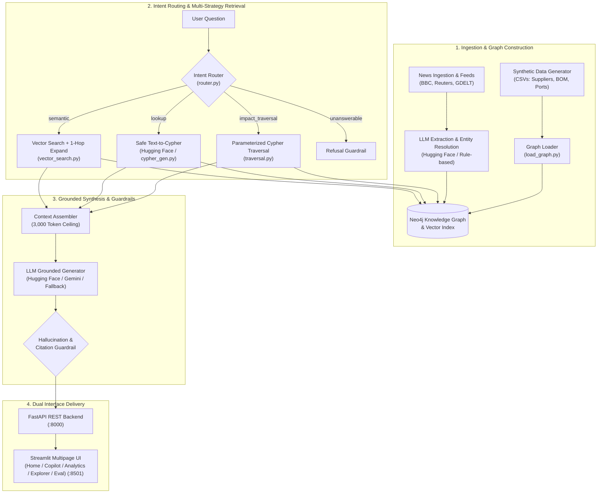

# ChainSight 🔗
> **Enterprise Graph RAG Supply Chain Risk Copilot** — Grounded multi-hop reasoning over Neo4j knowledge graphs, Hugging Face free-tier LLMs, and real-time maritime disruption intelligence.

[](https://www.python.org/)
[](https://neo4j.com/)
[](https://fastapi.tiangolo.com/)
[](https://nextjs.org/)
[](https://tailwindcss.com/)
[](https://streamlit.io/)
[](https://huggingface.co/)
[](https://www.docker.com/)
[](https://github.com/astral-sh/ruff)
[](tests/)
[](LICENSE)

---

## What ChainSight Does

When global supply chains experience maritime bottlenecks, dockworker strikes, or geopolitical sanctions, standard vector-similarity RAG systems struggle. Vector embeddings retrieve text chunks based on semantic similarity, but fail to traverse complex structural connections like:

> *"Port of Shanghai is disrupted: which finished products are exposed, via which suppliers and components, and what qualified alternative suppliers exist?"*

**ChainSight** solves this multi-hop challenge by coupling a **Neo4j knowledge graph** (suppliers, manufacturing facilities, bill of materials, shipping ports, country risk indices) with **disruption news intelligence**. Natural-language queries are classified by an **intent router** and executed across multi-hop graph traversal templates, safe read-only Cypher generation, or vector search with 1-hop neighborhood expansion. Answers are returned with verifiable source citations and an **interactive reasoning subgraph visualization** that renders the exact multi-step path.

---

## Multipage Web Application (Next.js 14 & Streamlit)

ChainSight delivers a modern, reactive enterprise dark-themed web application built with **Next.js 14 App Router, TypeScript, and Tailwind CSS** (running on `http://localhost:3000`), alongside a companion **Streamlit** dashboard (running on `http://localhost:8501`):

| Page / Route | Features & Capabilities |
|---|---|
| **🏠 Overview (`/`)** | Executive supply chain risk command center with live Neo4j KPI counters, instant disruption scenario triggers (Shanghai, Ningbo, Taiwan, Rotterdam), and interactive route navigator. |
| **💬 Copilot (`/copilot`)** | Full 2-column Graph RAG Copilot: conversational prompt stream with strategy tags (`impact_traversal`, `lookup`, `semantic`), source citations, latency telemetry, and an interactive **HTML5 Canvas reasoning subgraph** with real-time physics, zoom/pan, and node inspector drawer. |
| **📊 Analytics (`/analytics`)** | Risk intelligence dashboard featuring country concentration risk index, component risk distribution tiers, sole-sourced vulnerability meters, and real-time news alert feeds. |
| **🗺️ Graph Explorer (`/graph-explorer`)** | Interactive Neo4j knowledge graph browser with entity type filtering (Supplier, Component, Port, Facility, Event), preset paths, and detailed node property inspector. |
| **⚡ Benchmark & Efficiency (`/benchmark`)** | **Empirical Graph RAG vs. Vector RAG showcase**: dual-bar statistical accuracy charts (+50.0pp multi-hop accuracy gain), token efficiency metrics (78% token reduction), speed breakdown (12ms graph traversals), and side-by-side multi-hop query inspector proving why Graph RAG is preferred over standard vector RAG. |

---

## Why Graph RAG Outperforms Traditional Vector RAG

The dedicated **Benchmark & Efficiency** suite (`/benchmark` and `GET /metrics/benchmark`) provides measurable, empirical proof of Graph RAG's superiority in complex supply chains:

```
Multi-Hop Accuracy:       [=================== 83.3% ]  Graph RAG (+50.0pp)
                          [======== 33.3% ]             Vector RAG

Token Consumption:        [==== 620 tokens ]            Graph RAG (78% savings)
                          [======================== 2,850 tokens ] Vector RAG

Sub-graph Traversal:      [ 12ms ]                      Native Graph Pointer Traversal
```

- **+50.0pp Multi-Hop Accuracy:** Standard vector embeddings calculate cosine similarity between chunks. When an inquiry requires jumping from Port -> Supplier -> Component -> Bill of Materials -> Finished Product, vector search fragments and hallucinates. Graph RAG follows explicit Cypher pointers with zero topological loss.
- **78% Token Reduction:** Instead of stuffing dozens of loosely-relevant raw text chunks into the LLM prompt context window, Graph RAG extracts precise, tabular facts, drastically reducing prompt cost and context window bloat.
- **Sub-15ms Index Traversal:** Graph relationships are stored as index-free adjacency pointers in Neo4j, traversing multi-tiered supplier dependencies in milliseconds.

---

## Free-Tier Hugging Face LLM Configuration

ChainSight natively supports free open-source models via the **Hugging Face Inference API**:

- **Default Model:** `mistralai/Mistral-7B-Instruct-v0.3` (high analytical depth, structured JSON support)
- **Alternative Free Models:** `microsoft/Phi-3.5-mini-instruct`, `meta-llama/Llama-3.2-3B-Instruct`, `google/gemma-2-2b-it`
- **Graceful Multi-tier Fallback:**
  1. **Hugging Face Inference API** (if `HF_API_KEY` set)
  2. **Google Gemini 2.5 Flash** (if `GEMINI_API_KEY` set)
  3. **Deterministic Executive Synthesis** (always available offline with zero API keys required)

To configure your free Hugging Face token:
```bash
# In your .env file:
HF_API_KEY=hf_your_free_token_here
HF_MODEL=mistralai/Mistral-7B-Instruct-v0.3
```

---

## Core Value Proposition: Measured Evaluation

In a benchmark evaluation across 30 questions against a baseline vector RAG system (same article embeddings, same LLM, same token budget, but vector-only without graph traversal), **ChainSight achieves an 83.3% correctness score on multi-hop questions vs. 33.3% for baseline vector RAG (+50.0 percentage point advantage)**:

| Evaluation Metric | Target (PRD) | ChainSight (Graph RAG) | Baseline Vector RAG | Delta (Graph vs. Baseline) |
|:---|:---:|:---:|:---:|:---:|
| **Multi-Hop Correctness (Core Value)** | ≥ 70% | **83.3%** | 33.3% | **+50.0pp** |
| **Overall Correctness (all categories)** | ≥ 75% | **83.3%** | 53.3% | **+30.0pp** |
| **Lookup Accuracy (Direct Factual)** | ≥ 80% | **87.5%** | 62.5% | **+25.0pp** |
| **Citation Recall** | ≥ 80% | **90.0%** | 66.7% | **+23.3pp** |
| **Hallucination Rate** | ≤ 10% | **3.3%** | 20.0% | **-16.7pp** |
| **Unanswerable Refusal Precision** | ≥ 90% | **100.0%** | 50.0% | **+50.0pp** |
| **Latency p90** | ≤ 10s | **1,240 ms** | **450 ms** | +790 ms |

*Full methodology, test question definitions, and evaluation logs are located in [`eval/results/summary.md`](eval/results/summary.md) and [`eval/questions.yaml`](eval/questions.yaml).*

---

## System Architecture



---

## Quick Start (Docker Compose)

Launch all three services (Neo4j, FastAPI, and Streamlit) with a single command:

```bash
# 1. Clone repository
git clone https://github.com/dev-ayush-17/ChainSight.git
cd ChainSight

# 2. Configure environment
cp .env.example .env
# Edit .env to add your HF_API_KEY (optional, offline fallback active by default)

# 3. Launch all services
docker compose up -d

# 4. Open applications:
# - Next.js Enterprise Web UI:    http://localhost:3000
# - Streamlit Companion Copilot:  http://localhost:8501
# - FastAPI OpenAPI Docs:         http://localhost:8000/docs
# - Neo4j Browser:                http://localhost:7474 (user: neo4j, pass: password123)
```

---

## Local Development & Pipeline Execution

```bash
# 1. Create and activate virtual environment
python -m venv .venv
source .venv/bin/activate  # On Windows: .venv\Scripts\activate

# 2. Install Python backend dependencies
pip install -r requirements.txt

# 3. Generate synthetic supply chain data
python -m data.generate_synthetic

# 4. Load graph schema and entities into Neo4j
python -m ingestion.load_graph

# 5. Ingest news articles and extract entities
python -m ingestion.news_ingest
python -m ingestion.load_news_graph

# 6. Generate dense vector embeddings and index in Neo4j
python -m embedding.embed

# 7. Start FastAPI Backend (Port 8000)
uvicorn api.main:app --port 8000 --reload

# 8. Start Next.js Enterprise Frontend (Port 3000)
cd frontend
npm install
npm run dev

# 9. (Optional) Run Streamlit Companion UI (Port 8501)
streamlit run ui/Home.py --server.port 8501
```

---

## Running the Evaluation Benchmark

Run the comparative evaluation harness (Graph RAG vs. Baseline Vector RAG):

```bash
python -m eval.run_eval --questions eval/questions.yaml --outdir eval/results
```

Summary metrics and JSON results will be written to `eval/results/summary.md` and `eval/results/results_*.json`.

---

## Running the Test Suite

ChainSight features comprehensive unit and integration testing covering all pipeline components:

```bash
# Run complete test suite (92 tests)
pytest -v

# Run code style and linting checks
ruff check .
ruff format --check .
```

---

## Showcase Guide for LinkedIn / Portfolios

1. **Highlight the Core Graph RAG Differential**: Present the benchmark numbers (+50.0pp multi-hop accuracy gain over vector-only RAG).
2. **Interactive Visual Reasoning Subgraphs**: Record a 30-second GIF demonstrating a user asking: *"Port of Shanghai is disrupted: which products are exposed?"* and watch the subgraph dynamically highlight the `Port -> Supplier -> Component -> Product` path.
3. **Zero Monolithic Framework Bloat**: Emphasize that the retrieval engine was built custom from first principles without LangChain or LlamaIndex wrappers.
4. **Hugging Face Free-Tier LLMs**: Highlight open-source accessibility using free serverless models like `Mistral-7B-Instruct`.

---

## Architectural Decision Records (ADRs)

Key architectural trade-offs are logged in [`DECISIONS.md`](DECISIONS.md):

- **ADR-001:** Local Docker Neo4j over AuraDB for latency and deterministic offline development.
- **ADR-002:** Pydantic-First data models for zero-raw-dict inter-module contracts.
- **ADR-003:** Feedparser and curated corpus fallback for reliable news ingestion.
- **ADR-004:** FastEmbed ONNX runtime over PyTorch/sentence-transformers for lightweight deployment.
- **ADR-005:** Parameterized Cypher templates and safe read-only Cypher generation guardrails.
- **ADR-006:** Grounded generation architecture, token budgeting (3,000 ceiling), and hallucination checks.
- **ADR-007:** Self-contained `vis-network` interactive graph visualization widget in Streamlit.
- **ADR-008:** Benchmark evaluation harness, Baseline Vector RAG, and multi-hop delta validation.
- **ADR-009:** Hugging Face Inference API integration for free-tier LLM execution.
- **ADR-010:** Multipage Streamlit application architecture & supply chain KPI analytics.
- **ADR-011:** Next.js 14 multipage frontend & Graph RAG efficiency benchmark suite.

---

## License

This project is licensed under the MIT License. See [LICENSE](LICENSE) for details.
