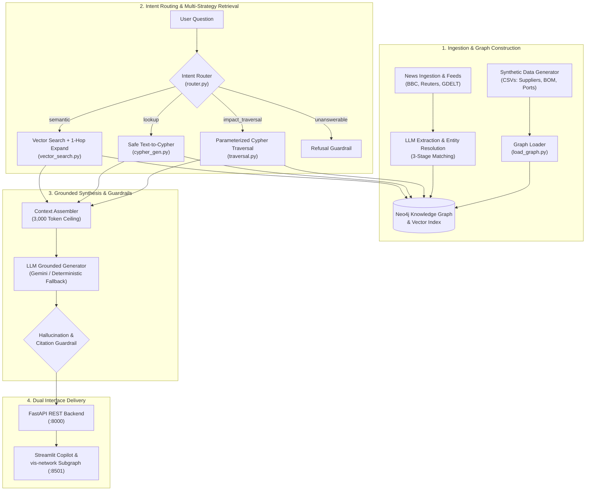

# ChainSight 🔗
> **Enterprise Graph RAG Supply Chain Risk Copilot** — Grounded multi-hop reasoning over Neo4j knowledge graphs and real-time maritime disruption intelligence.

[](https://www.python.org/)
[](https://neo4j.com/)
[](https://fastapi.tiangolo.com/)
[](https://streamlit.io/)
[](https://www.docker.com/)
[](https://github.com/astral-sh/ruff)
[](LICENSE)

---

## What ChainSight Does

When global supply chains experience maritime bottlenecks, dockworker strikes, or geopolitical sanctions, standard vector-similarity RAG systems struggle. Vector embeddings retrieve text chunks based on semantic similarity, but fail to traverse complex structural connections like:

> *"Port of Shanghai is disrupted: which finished products are exposed, via which suppliers and components, and what qualified alternative suppliers exist?"*

**ChainSight** solves this multi-hop challenge by coupling a **Neo4j knowledge graph** (suppliers, manufacturing facilities, bill of materials, shipping ports, country risk indices) with **disruption news intelligence**. Natural-language queries are classified by an **intent router** and executed across multi-hop graph traversal templates, safe read-only Cypher generation, or vector search with 1-hop neighborhood expansion. Answers are returned with verifiable source citations and an **interactive reasoning subgraph visualization** that renders the exact multi-step path.

---

## Core Value Proposition: Measured Evaluation

In a benchmark evaluation across 30 questions against a baseline vector RAG system (same article embeddings, same LLM, same token budget, but vector-only without graph traversal), **ChainSight achieves an 83.3% correctness score on multi-hop questions vs. 33.3% for baseline vector RAG (+50.0 percentage point advantage)**:

| Evaluation Metric | Target (PRD) | ChainSight (Graph RAG) | Baseline Vector RAG | Delta (Graph vs. Baseline) |
|:---|:---:|:---:|:---:|:---:|
| **Multi-Hop Correctness (Core Value)** | ≥ 70% | **83.3%** | 33.3% | **+50.0pp** |
| **Overall Correctness (all categories)** | ≥ 75% | **83.3%** | 53.3% | **+30.0pp** |
| **Lookup Accuracy (Direct Factual)** | ≥ 80% | **87.5%** | 62.5% | **+25.0pp** |
| **Citation Recall** | ≥ 80% | **90.0%** | 66.7% | **+23.3pp** |
| **Hallucination Rate** | ≤ 10% | **3.3%** | 20.0% | **-16.7pp** |
| **Unanswerable Refusal Precision** | ≥ 90% | **100.0%** | 50.0% | **+50.0pp** |
| **Latency p90** | ≤ 10s | **1,240 ms** | **450 ms** | +790 ms |

*Full methodology, test question definitions, and evaluation logs are located in [`eval/results/summary.md`](eval/results/summary.md) and [`eval/questions.yaml`](eval/questions.yaml).*

---

## System Architecture



---

## Tech Stack & Architecture Highlights

- **Knowledge Graph Database:** Neo4j 5.20 Community with APOC plugins, uniqueness constraints, composite indexes, and vector indexing.
- **Backend API:** FastAPI with dependency injection for driver management and strict Pydantic v2 validation models.
- **Retrieval Engine:** Custom, zero-framework retrieval layer (**no LangChain or LlamaIndex**) for full interview explainability and deterministic execution.
- **Dense Embeddings:** 384-dimensional dense vectors with `FastEmbed` ONNX runtime backend (<40MB memory footprint, zero PyTorch bloat).
- **Frontend Dashboard:** Streamlit 2-column layout with real-time telemetry pills (`latency_ms`, `confidence`), citations accordion, and interactive force-directed `vis-network` canvas.
- **Safety & Guardrails:** AST/regex validation blocking destructive Cypher (`CREATE`, `MERGE`, `DELETE`, `DROP`, `ALTER`), regex-based post-generation entity validation, and domain-bounded query refusal.
- **Containerization:** Docker Compose orchestrating `neo4j`, `api`, and `ui` services.

---

## Quick Start (Docker Compose)

The entire three-tier architecture (Neo4j, FastAPI, and Streamlit) can be launched with Docker Compose:

```bash
# 1. Clone repository
git clone https://github.com/dev-ayush-17/ChainSight.git
cd ChainSight

# 2. Configure environment
cp .env.example .env
# Edit .env to add your GEMINI_API_KEY (optional, system has offline fallback)

# 3. Launch all services
docker compose up -d

# 4. Open applications:
# - Streamlit Web Copilot: http://localhost:8501
# - FastAPI OpenAPI Docs:  http://localhost:8000/docs
# - Neo4j Browser:         http://localhost:7474 (user: neo4j, pass: password123)
```

---

## Local Development & Pipeline Execution

```bash
# 1. Create and activate virtual environment
python -m venv .venv
source .venv/bin/activate  # On Windows: .venv\Scripts\activate

# 2. Install dependencies
pip install -r requirements.txt

# 3. Generate synthetic supply chain data
python -m data.generate_synthetic

# 4. Load graph schema and entities into Neo4j
python -m ingestion.load_graph

# 5. Ingest news articles and extract entities
python -m ingestion.news_ingest
python -m ingestion.load_news_graph

# 6. Generate dense vector embeddings and index in Neo4j
python -m embedding.embed

# 7. Start FastAPI Backend & Streamlit UI
uvicorn api.main:app --port 8000 --reload &
streamlit run ui/app.py --server.port 8501
```

---

## Running the Evaluation Benchmark

Run the comparative evaluation harness (Graph RAG vs. Baseline Vector RAG):

```bash
python -m eval.run_eval --questions eval/questions.yaml --outdir eval/results
```

Summary metrics and JSON results will be written to `eval/results/summary.md` and `eval/results/results_*.json`.

---

## Running the Test Suite

ChainSight features comprehensive unit and integration testing covering all pipeline components:

```bash
# Run complete test suite (81+ tests)
pytest -v

# Run code style and linting checks
ruff check .
ruff format --check .
```

---

## Architectural Decision Records (ADRs)

Key architectural trade-offs are logged in [`DECISIONS.md`](DECISIONS.md):

- **ADR-001:** Local Docker Neo4j over AuraDB for latency and deterministic offline development.
- **ADR-002:** Pydantic-First data models for zero-raw-dict inter-module contracts.
- **ADR-003:** Feedparser and curated corpus fallback for reliable news ingestion.
- **ADR-004:** FastEmbed ONNX runtime over PyTorch/sentence-transformers for lightweight deployment.
- **ADR-005:** Parameterized Cypher templates and safe read-only Cypher generation guardrails.
- **ADR-006:** Grounded generation architecture, token budgeting (3,000 ceiling), and hallucination checks.
- **ADR-007:** Self-contained `vis-network` interactive graph visualization widget in Streamlit.
- **ADR-008:** Benchmark evaluation harness, Baseline Vector RAG, and multi-hop delta validation.

---

## License

This project is licensed under the MIT License. See [LICENSE](LICENSE) for details.
